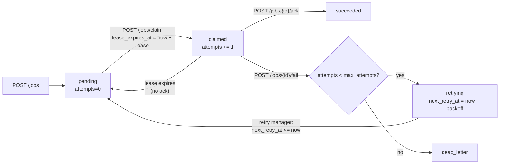

# Local Job Queue

[](https://github.com/forgeline-labs/local-job-queue/actions/workflows/ci.yml)

A small, durable job queue that runs as a single process. Producers enqueue
JSON jobs over HTTP, workers claim them with a time-based lease, and failed
jobs are retried automatically with exponential backoff until they succeed or
land in the dead-letter queue. State lives in SQLite, so restarts never lose
jobs, attempts, or scheduled retries. There is no Redis, broker, external
database, or third-party service — only the Python standard library and one
SQLite file.

Delivery is **at-least-once**. Claim order is `priority DESC`, then FIFO by
creation time.

---

## Quickstart

Requires Python 3.10+ (standard library only — no `pip install` needed).

```bash
git clone https://github.com/forgeline-labs/local-job-queue.git
cd local-job-queue
./serve --port 8080
```

The server is ready when `GET /health` returns `{"status":"ok"}` (well under
5 seconds). Data is stored in `./data/jobs.db` by default.

```bash
curl -s localhost:8080/health
# {"status":"ok"}
```

Run the black-box test suite with:

```bash
make test
```

Lint and formatting (requires `ruff`, see `pyproject.toml`):

```bash
make lint
```

---

## Examples

Every response below was captured from a real run of `./serve` (defaults:
`JOB_BACKOFF_BASE_MS=1000`, `JOB_MAX_ATTEMPTS=5`, `JOB_LEASE_MS=30000`) using
`curl`/`urllib`.

### `GET /health`

```bash
curl -s localhost:8080/health
```

```json
{"status":"ok"}
```

### `POST /jobs` — enqueue

```bash
curl -s -X POST localhost:8080/jobs \
  -H 'Content-Type: application/json' \
  -d '{"queue":"email_sending","priority":10,"payload":{"to":"user@example.com","subject":"Hello"},"max_attempts":5}'
```

```json
{"id":"job_e0cf2d5c7c9103cd5fda5eaa","queue":"email_sending","priority":10,"payload":{"to":"user@example.com","subject":"Hello"},"status":"pending","attempts":0,"max_attempts":5,"next_retry_at":null,"claimed_by":null,"lease_expires_at":null,"error":null,"created_at":"2026-10-22T01:53:10.103Z","updated_at":"2026-10-22T01:53:10.103Z"}
```

### `POST /jobs/claim` — claim a job with a lease

```bash
curl -s -X POST localhost:8080/jobs/claim \
  -H 'Content-Type: application/json' \
  -d '{"queue":"email_sending","lease_duration_ms":30000}'
```

```json
{"job":{"id":"job_e0cf2d5c7c9103cd5fda5eaa","queue":"email_sending","priority":10,"payload":{"to":"user@example.com","subject":"Hello"},"status":"claimed","attempts":1,"max_attempts":5,"next_retry_at":null,"claimed_by":"claimed_65482a09892d","lease_expires_at":"2026-10-22T01:53:40.108Z","error":null,"created_at":"2026-10-22T01:53:10.103Z","updated_at":"2026-10-22T01:53:10.108Z"}}
```

When the queue has no eligible job the response is `200` with `{"job":null}`.

### `POST /jobs/{id}/ack` — success

```bash
curl -s -X POST localhost:8080/jobs/job_e0cf2d5c7c9103cd5fda5eaa/ack
```

```json
{"id":"job_e0cf2d5c7c9103cd5fda5eaa","queue":"email_sending","priority":10,"payload":{"to":"user@example.com","subject":"Hello"},"status":"succeeded","attempts":1,"max_attempts":5,"next_retry_at":null,"claimed_by":null,"lease_expires_at":null,"error":null,"created_at":"2026-10-22T01:53:10.103Z","updated_at":"2026-10-22T01:53:10.110Z"}
```

### `POST /jobs/{id}/fail` — report a failure

```bash
curl -s -X POST localhost:8080/jobs/job_8c61cd3b9fe33ce123da2b00/fail \
  -H 'Content-Type: application/json' \
  -d '{"error":"SMTP connection timeout"}'
```

```json
{"id":"job_8c61cd3b9fe33ce123da2b00","queue":"email_sending","priority":20,"payload":{"to":"other@example.com"},"status":"retrying","attempts":1,"max_attempts":3,"next_retry_at":"2026-10-22T01:53:11.119Z","claimed_by":null,"lease_expires_at":null,"error":"SMTP connection timeout","created_at":"2026-10-22T01:53:10.113Z","updated_at":"2026-10-22T01:53:10.119Z"}
```

If `attempts >= max_attempts` the job becomes `dead_letter` instead:

```json
{"id":"job_1b8b7874f8149a7a079ecc28","queue":"email_sending","priority":5,"payload":{"to":"dead@example.com"},"status":"dead_letter","attempts":1,"max_attempts":1,"next_retry_at":null,"claimed_by":null,"lease_expires_at":null,"error":"permanent failure","created_at":"2026-10-22T01:53:10.123Z","updated_at":"2026-10-22T01:53:10.127Z"}
```

### `GET /jobs/{id}` — fetch one job

```bash
curl -s localhost:8080/jobs/job_8c61cd3b9fe33ce123da2b00
```

```json
{"id":"job_8c61cd3b9fe33ce123da2b00","queue":"email_sending","priority":20,"payload":{"to":"other@example.com"},"status":"retrying","attempts":1,"max_attempts":3,"next_retry_at":"2026-10-22T01:53:11.119Z","claimed_by":null,"lease_expires_at":null,"error":"SMTP connection timeout","created_at":"2026-10-22T01:53:10.113Z","updated_at":"2026-10-22T01:53:10.119Z"}
```

### `GET /jobs` — list with filters and pagination

```bash
curl -s 'localhost:8080/jobs?queue=email_sending&status=retrying&limit=2&offset=0'
```

```json
{"jobs":[{"id":"job_8c61cd3b9fe33ce123da2b00","queue":"email_sending","priority":20,"payload":{"to":"other@example.com"},"status":"retrying","attempts":1,"max_attempts":3,"next_retry_at":"2026-10-22T01:53:11.119Z","claimed_by":null,"lease_expires_at":null,"error":"SMTP connection timeout","created_at":"2026-10-22T01:53:10.113Z","updated_at":"2026-10-22T01:53:10.119Z"}],"total":1}
```

Ordering is `priority DESC`, then `created_at ASC`. `limit` defaults to `50`
and is clamped to `1..200` without an error; `offset` is clamped to `>= 0`.

### `GET /jobs/dead-letter` — list dead-letter jobs

```bash
curl -s localhost:8080/jobs/dead-letter
```

```json
{"jobs":[{"id":"job_1b8b7874f8149a7a079ecc28","queue":"email_sending","priority":5,"payload":{"to":"dead@example.com"},"status":"dead_letter","attempts":1,"max_attempts":1,"next_retry_at":null,"claimed_by":null,"lease_expires_at":null,"error":"permanent failure","created_at":"2026-10-22T01:53:10.123Z","updated_at":"2026-10-22T01:53:10.127Z"}],"total":1}
```

Dead-letter jobs are ordered `created_at DESC`.

### Error example

```bash
curl -s -X POST localhost:8080/jobs \
  -H 'Content-Type: application/json' -d '{"payload":{"x":1}}'
```

```json
{"error":{"code":"invalid_queue","message":"queue must be a non-empty string of at most 128 characters","details":{}}}
```

---

## Job lifecycle



- `pending` and due `retrying` jobs are claimable.
- `claimed` holds a lease; if it expires without an ack, a later claim may
  redeliver the job (at-least-once).
- `succeeded` and `dead_letter` are terminal.

---

## Backoff formula

Let `a` be the 1-based number of the attempt that just failed:

```
if a >= max_attempts:
    status = "dead_letter"
    next_retry_at = null
else:
    delay_ms = JOB_BACKOFF_BASE_MS * 2^(a - 1)
    status = "retrying"
    next_retry_at = now() + delay_ms
```

There is no jitter and no delay cap in v0.1, which keeps retries deterministic
for tests. With the default base of `1000 ms`:

| Failed attempt `a` | Delay | Result |
|---|---|---|
| 1 of 5 | 1000 ms | `retrying` |
| 2 of 5 | 2000 ms | `retrying` |
| 3 of 5 | 4000 ms | `retrying` |
| 4 of 5 | 8000 ms | `retrying` |
| 5 of 5 | — | `dead_letter` |

`attempts` is incremented on `claim` (before the worker runs), is durable, and
never resets on restart. A job that succeeds on its first try therefore reports
`attempts: 1`.

---

## Design decisions

- **SQLite as the durable queue.** One `jobs.db` file with WAL journaling gives
  atomic transitions and crash durability without an external broker. Every
  write is committed before the HTTP response is sent.
- **Lease instead of a separate ack timeout.** `claim` returns a lease
  (`lease_expires_at`). A crashed worker simply stops renewing; once the lease
  expires, the job returns to `pending` and another worker can claim it. This
  is what makes the at-least-once guarantee work without a heartbeat protocol.
- **Priority, then FIFO.** `claim` orders by `priority DESC, created_at ASC`
  (with insertion order as a tie-breaker), so urgent work wins while jobs of
  equal priority are processed in the order they were enqueued.
- **At-least-once and `claimed_by`.** Each claim generates a unique
  `claimed_by` identifier and a new `lease_expires_at`. A worker that lost its
  lease can be detected by the changed lease, and workers are expected to be
  idempotent by `job.id`.
- **Injectable clock.** `JOB_CURRENT_TIME_MS` is re-read on every operation, so
  tests can pin time and verify exact backoff and lease boundaries without
  sleeping. Production runs use the system clock when the variable is unset.
- **Stable error envelope and codes.** Every failure — including `404` and
  `405` — returns `{"error":{"code","message","details"}}`, so clients can
  branch on the stable `code` rather than on message text.
- **Clamped pagination.** Out-of-range `limit`/`offset` never produce a `400`;
  they are clamped. This keeps list polling simple and forgiving.

---

## Configuration

All values except `JOB_CURRENT_TIME_MS` are read once at process start.

| Variable | Default | Effect |
|---|---|---|
| `DATA_DIR` | `./data` | Directory containing `jobs.db` (created recursively) |
| `JOB_BACKOFF_BASE_MS` | `1000` | Exponential backoff base in milliseconds |
| `JOB_MAX_ATTEMPTS` | `5` | Default maximum attempts per job (including the first) |
| `JOB_LEASE_MS` | `30000` | Default lease duration in milliseconds |
| `JOB_CURRENT_TIME_MS` | unset | Fixed Unix-epoch clock in milliseconds; re-read on every operation |

CLI options:

- `--port N` — TCP port `1..65535` (default `8080`)
- `--data-dir PATH` — overrides `DATA_DIR`
- `--help` — print usage and exit `0`

Invalid configuration, an occupied port, or an unwritable data directory prints
a message to `stderr` and exits with code `1`.

For fast deterministic runs, use
`JOB_BACKOFF_BASE_MS=50 JOB_MAX_ATTEMPTS=3 JOB_LEASE_MS=500`.

---

## API reference

All request/response bodies are `application/json; charset=utf-8`. Timestamps
are RFC 3339 UTC with millisecond precision (`2026-10-06T12:00:00.123Z`).
Job IDs are opaque strings shaped `job_<24 hex>`. Unknown request fields are
ignored.

| Method | Path | Description | Success |
|---|---|---|---|
| `GET` | `/health` | Liveness check | `200 {"status":"ok"}` |
| `POST` | `/jobs` | Enqueue a job | `202` job |
| `GET` | `/jobs` | List jobs (`queue`, `status`, `limit`, `offset`) | `200 {"jobs":[...],"total":N}` |
| `GET` | `/jobs/{id}` | Fetch a job | `200` job |
| `POST` | `/jobs/claim` | Claim the next eligible job (`queue`, `lease_duration_ms`) | `200 {"job": job-or-null}` |
| `POST` | `/jobs/{id}/ack` | Acknowledge success | `200` job |
| `POST` | `/jobs/{id}/fail` | Report failure (`error` optional) | `200` job |
| `GET` | `/jobs/dead-letter` | List dead-letter jobs (`queue`, `limit`, `offset`) | `200 {"jobs":[...],"total":N}` |

Enqueue validation: `queue` non-empty and ≤ 128 chars; `payload` must be a JSON
object (serialized size ≤ 262144 bytes); `priority` integer `0..100` (default
`10`); `max_attempts` integer `≥ 1` (defaults to `JOB_MAX_ATTEMPTS`). A
per-job `max_attempts` is not capped by the environment value.

### Error catalog

`details` is always an object (possibly `{}`).

| HTTP | `code` | When |
|---|---|---|
| 400 | `invalid_json` | Malformed body, or missing/wrong `Content-Type` |
| 404 | `not_found` | Unknown path or resource |
| 405 | `method_not_allowed` | Method not supported on a known path |
| 409 | `conflict` | Operation incompatible with the current state (e.g. ack of a non-claimed job) |
| 413 | `payload_too_large` | Serialized `payload` exceeds 262144 bytes |
| 422 | `invalid_queue` | `queue` missing, empty, or longer than 128 chars |
| 422 | `invalid_payload` | `payload` missing or not a JSON object |
| 422 | `invalid_priority` | `priority` missing, non-integer, or outside `0..100` |
| 422 | `invalid_max_attempts` | `max_attempts` non-integer or `< 1` |
| 422 | `lease_duration_required` | `lease_duration_ms` missing or non-positive on claim |
| 500 | `internal_error` | Unexpected server failure |

---

## Concurrency model

The service is a single process with a threaded HTTP server and one SQLite
connection guarded by a process-wide lock. `claim`, `ack` and `fail` run inside
`BEGIN IMMEDIATE` transactions: reading the next eligible job and marking it
`claimed` is a single atomic critical section, so two workers polling the same
queue concurrently can never receive the same job — exactly one gets it and the
other gets `{"job":null}`. The same transactions also serialise writers if a
second process opens the same database file. SQLite's WAL mode keeps readers
from blocking the writer.

A background retry manager sweeps roughly every 50 ms, and every request also
performs a sweep before reading state. It (a) returns claimed jobs whose lease
expired to `pending`, and (b) makes due `retrying` jobs claimable again. Both
transitions are durable and survive restarts.

---

## Limitations (v0.1)

| # | Limitation |
|---|---|
| L-1 | **At-least-once**: jobs may be redelivered after a lease expires or a crash; workers must be idempotent by `job.id`. |
| L-2 | No coordination for remote workers beyond polling `POST /jobs/claim`. |
| L-3 | **Head-of-line blocking**: a frequently failing job does not delay higher-priority jobs, but can delay lower-priority jobs in the same queue (priority + FIFO). |
| L-4 | No jitter and no delay cap in backoff — retry bursts can synchronise. |
| L-5 | No authentication on the admin API; run only on a trusted network. |
| L-6 | Single-node only: no failover, HA, or horizontal scaling. |
| L-7 | The injectable clock (`JOB_CURRENT_TIME_MS`) is global — every job in a test shares the same time. |

---

## How this was built

This project is an AI-agent portfolio exercise. The specification was written
first, in Portuguese, and the implementation was produced by an **autonomous AI
coding agent** from an internal harness, with no human editing of the code.
The black-box acceptance tests used to grade it were written by a **different,
independent AI agent** working only from the specification, without access to
the implementation; those tests live outside this repository and are run by the
harness.

Working from a spec with explicitly numbered edge cases shaped the design: the
error codes and envelope are treated as a stable contract, pagination is clamped
instead of rejected, and the clock is injectable and re-read per operation so
that lease expiry and backoff can be verified deterministically. The in-repo
`tests/` suite is a development-time black-box suite that starts the real
`./serve` binary and talks only HTTP, mirroring the acceptance criteria AC-1
through AC-20; unlike the grading suite, it was written alongside the
implementation.

---

## License

MIT — see [LICENSE](LICENSE).

## Windows

Use Python 3 from PATH. PowerShell and cmd can run `serve.cmd`;
`python serve` invokes the same entry point. UTF-8 output and LF line endings
are consistent across platforms. CI runs the visible suite on Ubuntu and Windows.
